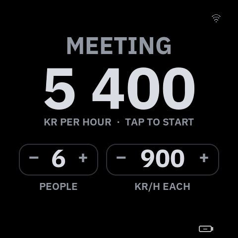
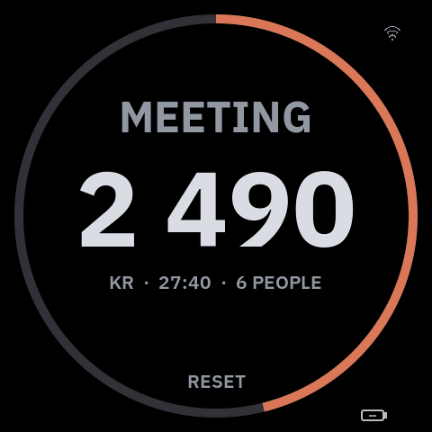
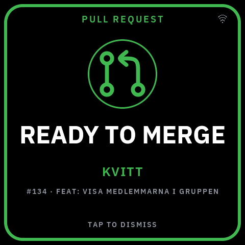
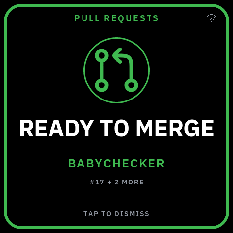

VibePulse v1.2.0 is the first release of the independent continuation. The panel gets a READY TO MERGE card for pull requests your review agents have finished, and the opt-in TID app grows from a silent clock into a desk companion: it chimes, it meters what a meeting costs, and it keeps the glass when the WiFi is gone. A fitted cell shows as a battery badge, the onboard RTC keeps the clock and drives scheduled night dimming, internal RAM has more room, and the Waveshare 2.41 V2 has its own board profile.

> **Verification status.** Every firmware claim below names the unit it was seen on. What was *not* seen on a panel is listed at the end. Releases are source-only: build with your own `secrets.h`.

## A meeting meter in TID

Stand the 2.16 panel with the buttons up and TID shows a meeting meter instead of the old 20/40/50 minute timer. Set the number of people (1–99) and kr per person and hour (100–5 000) with − and +, tap the hourly price, and the big number counts the meeting's cost in kronor with the elapsed time under it and a ring that laps once per hour. Pause, resume and RESET as before; the setting is saved on the panel when a meeting starts. Ten hours is the cap.

  
  &nbsp;
  

<em>Simulator captures, 480 × 480: before the meeting (left) and 27 minutes in (right).</em>

Seen and accepted on `torget-216-02` on 2026-11-02. The owner's first minutes with the steppers found that a quick tap beside − or + started a meeting by mistake; in the setup face only the band over the hourly price starts one now.

## TID keeps the glass without a network

Offline, the shared network layers used to cover TID's clock: the boot screen for 45 s, then NO NETWORK from 60 s, then a setup window that opened by itself at 90 s and kept coming back. Apps now declare `works_offline` in the app contract. While TID or the launcher is on the glass, the boot screen leaves at once and neither NO NETWORK nor the self-opening setup window takes the glass; the clock runs on the RTC. VibePulse keeps its honest NO DATA, NO NETWORK and setup steps, counted from when it took the glass, and WIFI under SETTINGS opens the window from any app.

Seen on `torget-216-02` on 2026-11-02: with the clock in front and the panel blocked from the WiFi, the clock stood for over two minutes; after a switch to VibePulse, NO NETWORK came at ~60 s and the setup window at ~90 s.

## TID can chime

Three rising notes (C6, E6, G6) when a focus phase ends, also while another app is on the glass; two falling notes (G5, E5) when a pomodoro break is over. Silent at night and while the maintenance window is open. The speaker symbol on the clock face turns it on and off, and the engine (`components/torget_audio`) borrows I2S and the codec per chime behind a DMA-margin check. Compiled in only with `TK_TID_SOUND`. Heard on `torget-216-02` (2026-10-05 and 2026-10-07).

## READY TO MERGE

`/api/merge-queue` on the host lists pull requests that local agent-team orchestrators have reviewed and that wait for a person to merge them. The 2.16 panel shows them as a green card on the completion surface: the project and `#N · TITLE` (or `#N + K MORE`). A new pull request pulses for 45 s, then the card stays still until a tap dismisses it. NEEDS YOU and a finished agent always take precedence.

  
  &nbsp;
  

<em>Simulator captures: one pull request (left), several (right).</em>

First seen on `torget-216-02` on 2026-10-08. Not yet reviewed as a static AMOLED frame; 2.16 only (`TK_MERGE_QUEUE`).

## Needs You comes forward from any app

A visible Needs You now claims the glass: the platform brings VibePulse forward and returns to what was showing once the answer's payoff beat ends. Claude's waiting pulse borrows the glass the same way, and TID shows a small orange Claude mark above its clock while Claude waits. Verified on the owner's 2.16 panel (2026-09-26 and 2026-09-30).

## Battery, RTC and night dimming

With the optional cell fitted, the 2.16 panel shows charge state and the PMU's percentage bottom-right, caps brightness at the night level below 20 %, and lists power in SETTINGS → ABOUT. The onboard PCF85063 RTC keeps the clock across a power-on boot when its reading is trustworthy, NTP time is written back after every sync, and the LABS row NIGHT DIM dims the glass between `TG_NIGHT_START_HHMM` and `TG_NIGHT_END_HHMM` whenever the clock is valid. Local time comes from `TG_TIMEZONE`. Seen on `torget-216-02` on 2026-09-25.

## More room in internal RAM

48.6 KB of static data moved from internal RAM to PSRAM and the panel logs its task stacks once a minute. Measured on `torget-216-02` (2026-10-08): the largest free internal block went from a pinned 31 744 B to 57–65 KB. An existing `sdkconfig` needs `CONFIG_SPIRAM_ALLOW_BSS_SEG_EXTERNAL_MEMORY` and `CONFIG_FREERTOS_USE_TRACE_FACILITY` and an `idf.py reconfigure`; a CMake guard says so.

## Waveshare 2.41 V2

`TORGET_BOARD=waveshare_241_v2` builds the fixed 600 × 450 landscape profile with the V2 wiring, paired touch rotation, BOOT as the settings input and native UI margins. Physical evidence from 2026-09-17 covers the board profile; OTA, auto-rotation and interaction replies are not claimed on V2. See `docs/waveshare-241-v2.md`.

## On the host

- Claude and Codex approvals share one strict shell-command classifier, so a Bash permission is judged by its flags and argument shape, not by its first word (found in the 2026-09-22 security review).
- `vibepulse_setup.py agents ignore <path>` keeps finished automation (an orchestrator's reviewer, say) off the agent monitor.
- `tools/ota-flash.sh` reports a failed upload as a failure: exit 0 only for HTTP 202, and 570 s for a slow but healthy stream.
- UPDATE READY no longer goes deaf after a tap on LATER.
- `TK_CODEX_PAGES 0` hides the Codex pages for a Claude-only desk.
- Claude Code's statusLine can feed the quota windows (macOS install, single account).
- The host test suites run about four times faster.

## Not seen on a panel

- The meeting meter's hourly ring lap, its 10 h cap and the saved setup across a power cycle (host- and simulator-tested).
- A cold boot of TID without a network (host-tested).
- The READY TO MERGE card as a static AMOLED review, and its stack margin.
- The battery badge's hour-long run and the RTC's backup supply through a power loss.
- The Windows v1 host claim stays pinned to the v1.0.0 runtime.

Full details in [CHANGELOG.md](https://github.com/ftornberg/vibepulse/blob/v1.2.0/CHANGELOG.md). [Compare v1.1.0...v1.2.0](https://github.com/ftornberg/vibepulse/compare/v1.1.0...v1.2.0).
